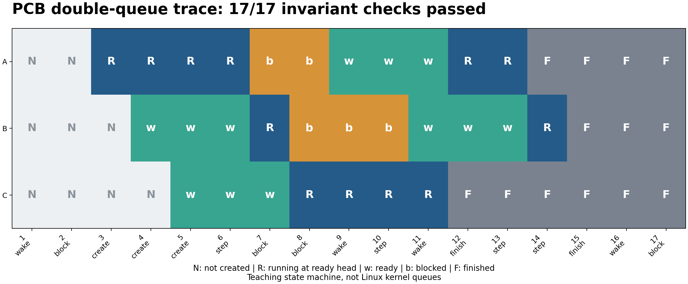
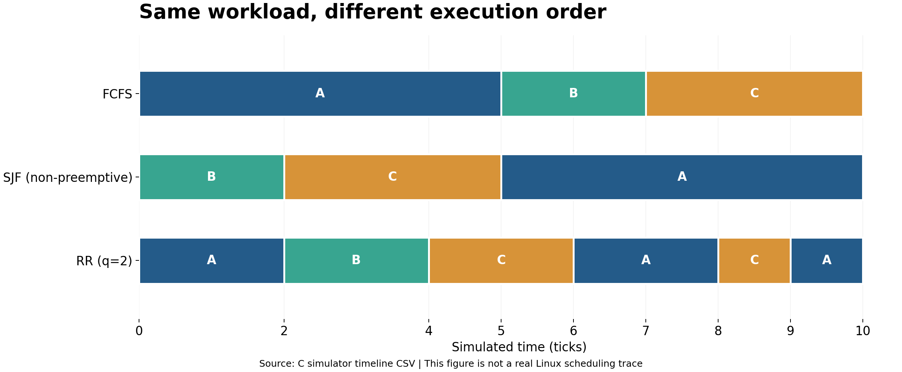
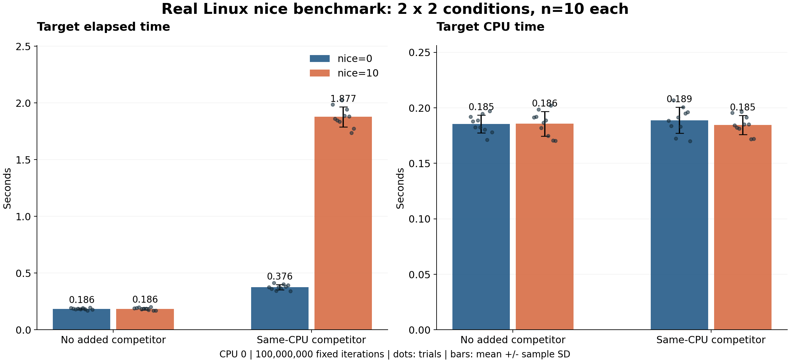

# Linux 进程管理实验扩展

上海电力大学 · 2024 级数据科学与大数据技术 · 操作系统课程第六组。代码与扩展实验维护：**[李玥辰 / YueChenLi-lab](https://github.com/YueChenLi-lab)**。原课程汇报的小组署名保留在 PPT 中。

本独立项目把“运行一次、人工观察”补成可验证的实验闭环：**PCB 队列自动检查、统一负载的三算法比较、nice 的多轮控制变量测量**。C 实现核心实验，Python 只分析日志和绘图。它不是 Linux 0.11 内核改造，也未修改其他项目。

| 模块 | 执行对象 | 输出证据 | 本次状态 |
|---|---|---|---|
| PCB 双队列 | 确定性 C 教学状态机 | 每步事件/快照/不变量 CSV | 3,550,381 条断言通过；50,000 次参考模型操作 |
| FCFS / 非抢占 SJF / RR | 同一 CSV 的 C 调度模拟器 | 逐任务指标、完整时间线、甘特图 | 124 条断言通过；理论时间线吻合 |
| nice 2×2 | 真实 Linux fork 子进程 | 实际 nice/CPU、wall/CPU 时间、退出状态、竞争生命周期 | 正式 40 次，四条件各 10 轮；另有 4 次 smoke |

另有 **33 项 CLI 检查通过**。所有成功断言数量来自真实 `make test` 输出，[原始测试日志](results/tests.log)可查。断言数量不等于独立测试案例数。工作流已配置，云端 CI 状态以 GitHub Actions 实际运行结果为准。

## 快速运行

需要常见 Linux、GCC、GNU Make；图表还需要 Python 3 和 Matplotlib。nice 使用 Linux 亲和性 API，父进程应为普通 SCHED_OTHER、初始 nice=0，不需要 root，不尝试提权。

```bash
make                         # gcc -std=c11 -O2 -Wall -Wextra -Werror
make test                    # C 断言 + CLI，无计时实验/绘图依赖
python3 -m pip install -r requirements.txt
make demo                    # PCB CSV、两份输入的三算法指标及 PNG/SVG
make benchmark               # 4 条件各 10 轮；生成汇总与误差线图
```

完整重现（会替换当前 checkout 内生成的 results，保留旧运行请先复制目录）：

```bash
bash scripts/run_all.sh
```

逐模块操作：

```bash
./build/pcb_queues --help
./build/pcb_queues --demo
./build/pcb_queues --scenario examples/queue_scenario.txt
./build/scheduler examples/workload_baseline.csv rr 2 results/schedule/rr
./build/nice_benchmark --help
# 小规模 smoke；成功后再运行完整实验
./build/nice_benchmark --rounds 1 --iterations 5000000 --seed 20261029 --output /tmp/nice-smoke.csv
# CPU 会从实际允许掩码中自动选取，也可以 --cpu N 指定允许的 CPU
./build/nice_benchmark --rounds 10 --iterations 100000000 --seed 20261029 --output /tmp/nice.csv
python3 scripts/analyze_benchmark.py /tmp/nice.csv /tmp/nice-analysis
```

`make demo` 与 `make benchmark` 必须先安装 Matplotlib；CI 只编译并测试 C。输出目录不存在时请先 `mkdir -p`。所有 CLI 非法输入、系统调用失败和不变量失败均非零退出，不吞失败。

## 1. PCB 双队列：把摘链/挂链的正确性变成检查项

教学 PCB 保留 `name/state/ntime/rtime/link`。`ready.head/tail` 对应原模型 `ready/pfend`，`blocked.head/tail` 对应 `stop/stepend`。**运行节点留在 ready 队首，状态为 R；其他就绪节点为 w，阻塞节点为 b，完成节点为 F。** 这两条用户态链表不代表真实内核运行队列。

`create/step/block/wake/finish` 每事件检查：活动 PCB 唯一归属、不丢失、不重复、无环、头尾一致、尾 next 为空、状态和位置对应；已完成节点不在活动队列。空队列 block/wake 是记入 CSV 的 NOOP。删除最后节点必须同时清空 head/tail，否则下一次挂链可能访问失效尾指针。

除单节点、空队列、连续操作和完成边界外，测试使用独立 FIFO 数组模型对照 10 个种子各 5000 次操作，并主动制造 7 类破坏验证检测器。`finish` 是直接完成当前工作量的教学控制，`step` 才模拟一个 tick。



## 2. 调度比较：固定输入后再谈性能

共享输入为 `A(0,5), B(0,2), C(0,3)`，RR 时间片 2。下表来自 C 程序实际执行的确定性模拟输出，单位为模拟 tick。它同时与理论参考值进行断言核对，**不是宿主 Linux 调度器的性能测量**。

| 算法 | 平均等待 | 平均周转 | 平均首次响应 | 上下文切换 |
|---|---:|---:|---:|---:|
| FCFS | 4.000000 | 7.333333 | 4.000000 | 2 |
| 非抢占 SJF | 2.333333 | 5.666667 | 2.333333 | 2 |
| RR，q=2 | 4.333333 | 7.666667 | 2.000000 | 5 |



- `turnaround = completion - arrival`
- `waiting = turnaround - burst`
- `response = first_start - arrival`
- 上下文切换只计连续的非 IDLE 执行片段发生任务 ID 改变；首次派发、进入/离开 IDLE 和同任务跨时间片不计。
- tie-break：FCFS 按到达/输入顺序；SJF 在已到达任务中按 burst、到达、输入顺序选择；RR 在片段结束时先纳入新到达任务再把当前未完成任务放队尾。

本输入下 SJF 平均等待较低，RR 首次响应较快且切换较多。模拟未计切换开销、无 I/O 且 SJF 已知 burst，不能推广为普适排名。不同到达时间/空闲段的第二份输入也已执行，[数据与图](results/schedule/arrivals/)。

## 3. nice：2×2 控制变量的真实 Linux 测量

本次环境：Ubuntu 24.04.3 LTS，Linux 6.18.55，x86_64；GCC 13.3.0，`-O2`；目标固定 100000000 次运算；实际可用并验证的 CPU 为 0；seed=20261029。每一轮四条件随机排列，共 10 轮，无删点。每个竞争者 nice=0，与目标绑在同一 CPU，在目标退出后停止并回收。

| 额外竞争 | 目标 nice | n | 经历时间均值 / s | 中位数 / s | 样本标准差 / s | CPU 时间均值 / s |
|---|---:|---:|---:|---:|---:|---:|
| 无 | 0 | 10 | 0.185523 | 0.185197 | 0.007964 | 0.185499 |
| 无 | 10 | 10 | 0.185739 | 0.187737 | 0.011107 | 0.185712 |
| 有 | 0 | 10 | 0.376089 | 0.376986 | 0.023521 | 0.188780 |
| 有 | 10 | 10 | 1.877433 | 1.871111 | 0.089398 | 0.184536 |



无额外竞争时两组经历时间接近；有同 CPU 竞争时，nice=10 目标平均经历时间约为 nice=0 的 4.99 倍，而目标 CPU 时间仍约 0.185 秒。本次现象与“nice 影响竞争中的相对调度份额”一致，不能推出计算指令本身变慢，也不预设其他环境下的方向/倍率。**误差线为样本标准差，不是置信区间；未做显著性检验。**

时钟从子进程越过启动门后开始，工作完成即结束，不包含 fork、设优先级或父进程 wait 时间。竞争任务固定代码、输入、CPU、nice 和运算 chunk，持续至目标退出；其总迭代数随生命周期变化，已记录，不能声称竞争者总工作量相等。门同步不能消除同一 CPU 上的启动时间差，原始表保留 start_skew。

[40 次正式原始 CSV](results/nice/raw.csv) · [汇总 CSV](results/nice/summary.csv) · [汇总 JSON](results/nice/summary.json) · [全部轮次图](results/nice/nice_rounds.png) · [环境及源码哈希](results/environment.txt)

原汇报中的五子进程、nice=0/10 均值约 3.634/4.247 秒，只是**原报告的单轮观测**。本次是单目标 + 可选竞争者的不同场景，不合并统计。宿主其他工作、虚拟化、CPU 频率、调度组、cgroup 配额及短测量瞬态仍会影响结果；无“额外竞争”不等于系统绝对空闲。结果只说明本次机器/负载下的现象。

## 测试、失败与可追溯性

- `make test`：3,550,381 条 PCB 断言 + 124 条调度断言 + 33 项 CLI 检查，实际全部通过。[日志](results/tests.log)
- 教学模块的 AddressSanitizer + UndefinedBehaviorSanitizer 检查通过，`ASAN_OPTIONS=detect_leaks=0`。[日志](results/sanitizers.log)
- LeakSanitizer 默认模式因环境无法读取 `/proc/.../task` 而失败，**未完成泄漏检查**；保留[失败日志](results/sanitizers_lsan_unavailable.log)。这与地址/未定义行为检查分开记录。
- nice 正式 40 次 + smoke 4 次均成功；[运行 stderr](results/nice/run.stderr.log)与 CSV 的原始 wait 状态可核对。
- 特意把巨大负载限制为 1 秒，触发预期超时，程序退出 1、清理全部已创建子进程。[失败验证日志](results/nice/timeout_validation.log)和 [FAIL CSV](results/nice/timeout_validation.csv)不参加性能汇总。
- 最初编译发现一处 misleading-indentation，被 `-Werror` 拒绝；已拆行修复。正式结果来自修复后构建。
- [来源清单](results/provenance.json)记录命令、退出状态、输入/源代码/正式数据/图表的 SHA-256；没有用旧报告数字生成新实测数据。

## 两份 PPT 与可直接打开的预览

原件未编辑，改用可读的仓库文件名；SHA-256 与上传附件逐字节一致。

| 文件 | PPTX 原件 | PDF 全页预览 |
|---|---|---|
| 原实验汇报，30 页 | [report_original.pptx](docs/slides/report_original.pptx) | [report_original.pdf](docs/slides/report_original.pdf) |
| 创新方案，3 页 | [innovation_original.pptx](docs/slides/innovation_original.pptx) | [innovation_original.pdf](docs/slides/innovation_original.pdf) |

GitHub 不原生渲染 PPTX，因此附 PDF 和 PNG；[三页创新图与汇报封面](docs/slides/README.md)可在仓库页面预览。预览继承仓库权限，**私有仓库只有有访问权的账号能查看**。附件 PDF 本身未加密、无口令；这不自动给陌生账号 GitHub 读取权限。原创新 PPT 仍写“待代码验证”，本次结果以本 README 和 results 为准；未伪造或覆盖原页。

三张创新页的 45–70 秒讲稿、现场命令、追问答复及实测插图位置见 [presentation_notes.md](docs/presentation_notes.md)。控制变量、指标和边界见 [experiment_methodology.md](docs/experiment_methodology.md)。

## 文件导航

- `src/`：三个 C 主程序；`include/parse.h`：严格数字解析。
- `tests/`：CLI 边界检查，C 断言测试内置于 `--test`。
- `examples/`：统一基准输入、到达/空闲输入、PCB 场景。
- `scripts/`：运行、环境记录、统计与画图。
- `results/`：真实生成的日志、CSV、JSON、PNG/SVG 和来源清单，非二进制程序。
- `docs/`：方法、讲稿和两份原始 PPT/PDF 及 PNG 预览。
- `.github/workflows/ci.yml`：只编译/快测，不测共享 runner 的 nice 时间。

新代码采用 MIT；上传原 PPT 保留其小组作者署名，不以代码许可证重新授权。
