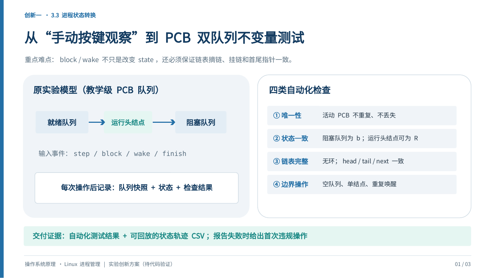
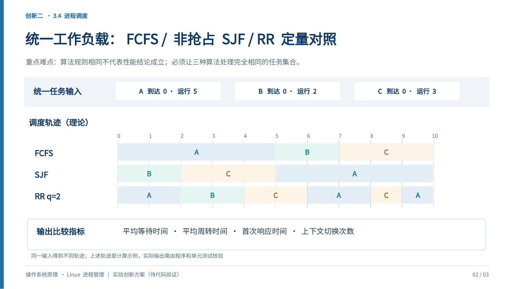
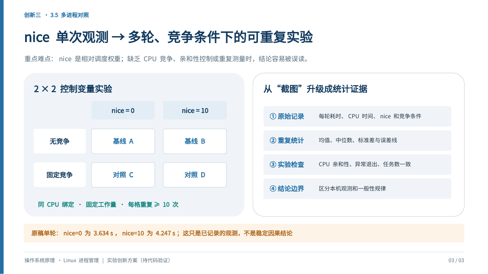
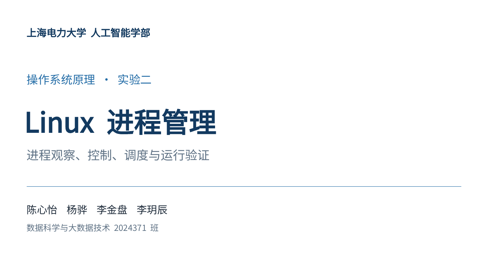

# 原始 PPT 与预览

上传原件仅重命名复制，内容未改。PDF 用 LibreOffice 导出，PNG 用 Poppler 从 PDF 渲染。PDF 未加密、没有查看口令。原件字体使用 Noto Sans CJK SC 回退显示，因此 PDF 是方便阅读的导出副本，排版以 PPT 原文件在 PowerPoint 中显示为准。

| 原上传文件 | 仓库文件 | 页数 | SHA-256 |
|---|---|---:|---|
| Linux进程管理_汇报版(2).pptx | [PPTX](report_original.pptx) / [PDF](report_original.pdf) | 30 | a3f93533556115e7c50a8a753f6de051b371f9af881e19d2f787f2f9f139e60a |
| LinuxBFE78BAEE786_AEE98C88E6B0_3A1%B5.pptx | [PPTX](innovation_original.pptx) / [PDF](innovation_original.pdf) | 3 | 43b3fe84952b88145848fa622a8aea5971174cdd919ba75cde79b308fd165c23 |

PNG 可直接在 GitHub 页面预览，原始 PPT 中的待验证字样被保留，本次实测结果另见根 README。

## 创新方案第 1 页

## 创新方案第 2 页

## 创新方案第 3 页

## 课程汇报封面

## 查看权限

上述文件继承仓库权限，私有仓库的授权读者可查看全部 PDF/PNG 并下载 PPT。PDF 无密码不等于仓库公开。没有通过模糊的“预览权限”推断公开仓库、邀请陌生账号或向整个组织开放。若需要其他人在线查看，需另行指定接收账号或明确公开范围。
